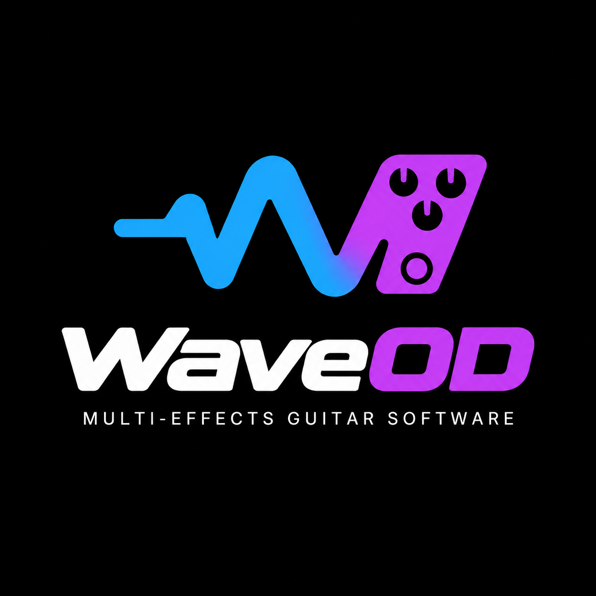
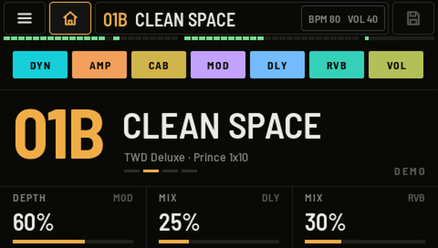
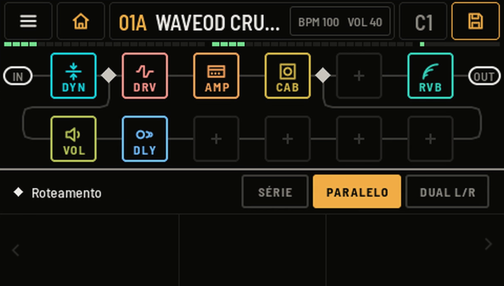
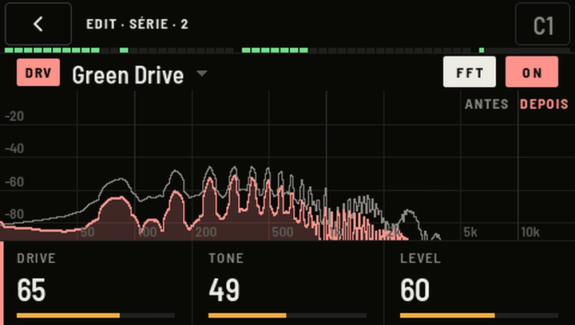
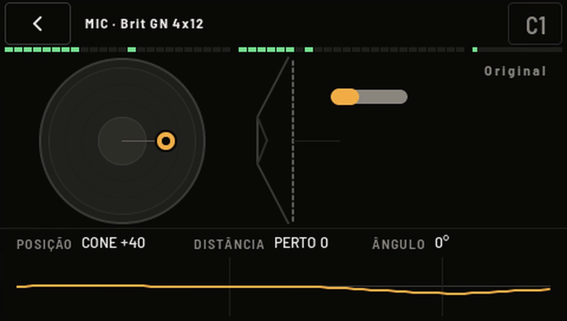
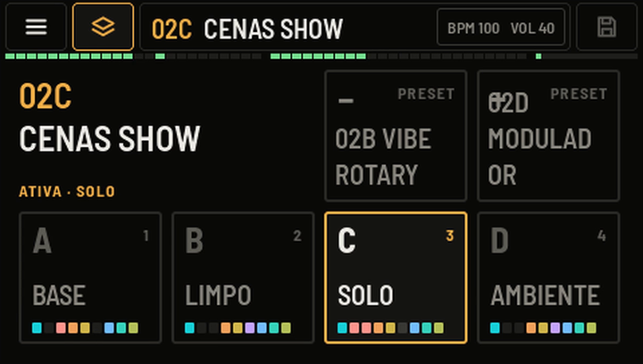
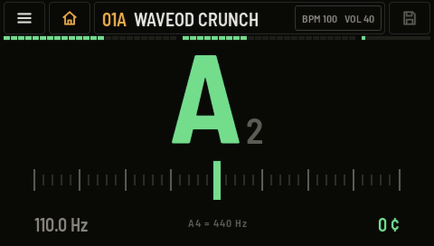
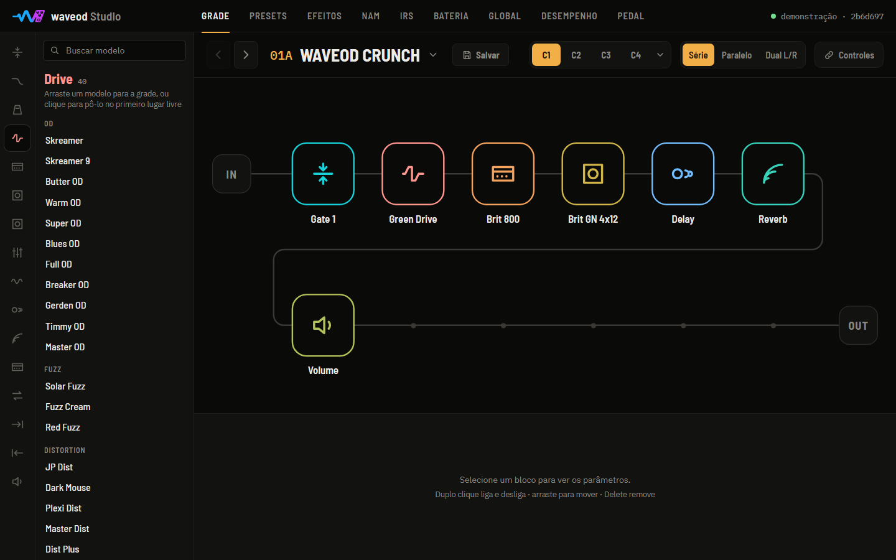
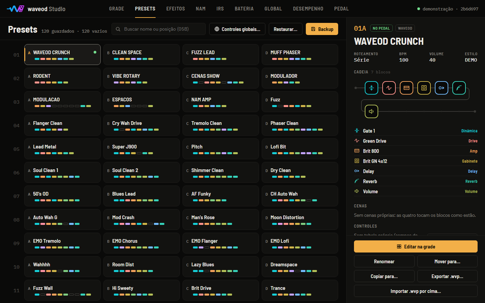

<p align="center"></p>

# waveod

**A new brain for the Sonicake Matribox II Pro (QME-200).** waveod is an open firmware for the pedal, written
from scratch in C: a new interface, a new effect engine and a PC app of its own, on the hardware you already own.
Nothing is lost on the way: your presets, IRs and Clone captures stay where they are, every stock effect is
still there, and the stock firmware is one update away.

> waveod is an unofficial open-source project, provided as is: read the [disclaimer](#disclaimer) before you
> install it.

<p align="center">
  
  
</p>

## Why waveod

- **Every stock effect, in readable C.** All 59 amps, 4 bass and acoustic preamps, 24 drives, 23 modulations, 17 delays,
  12 reverbs, 14 dynamics, 8 filter and pitch effects, 6 wahs and 5 EQs were rewritten from the stock firmware,
  bit for bit the same sound, and then optimised: about 30% fewer CPU cycles than the originals.
- **NAM in the Clone slots.** A native Neural Amp Modeler engine plays your `.nam` captures, at 44.1 kHz or at
  48 kHz through a resampler; waveod Studio also converts any `.nam` into a capture the stock Clone engine plays.
- **Cabinets with a virtual mic.** waveod's own Cab / IR engine, with mic position, distance, angle and type.
- **Drives that run the circuit.** Big Muff, TS808, RAT, Fuzz Face and Rangemaster simulated component by
  component, in real time.
- **Light, rich modulation and ambience.** Chorus (23 types), Flanger (32), Phaser, Rotary, Vibe, Tremolo,
  a 24-type Delay, a 50-type Reverb, Plate and Spring, each at a fraction of the CPU of a full implementation.
- **Routing your way.** A 2 x 6 grid with series, parallel and dual L/R chains, drag and drop on the touch
  screen.
- **A preset is a performance.** Four scenes per preset, four modulators (LFO, envelope, step sequencer) that move
  any knob, and a control table for footswitches, expression pedals and MIDI (learn, MIDI out).
- **Musician's tools built in.** Tuner (needle or strobe), looper, drum machine with your own rhythms from MIDI
  files, global EQ, a live spectrum analyser, delay and reverb tails that ring over the next preset, and an
  input → output latency meter.
- **Open to your own effects.** A small C SDK (`src/sdk/wvfx.h`): build a block, install it from the PC without a
  firmware update, and measure its CPU cycles on the pedal itself.
- **Safe by design.** Crash protection (a fault restarts the pedal and skips a preset that keeps crashing), the
  bootloader write-protected in the flash chip, and the recovery mode always available.

## On the pedal

| | |
|---|---|
|  |  |
| Edit any block with a live spectrum of its input and output | Place the mic on the speaker: position, distance, angle, type |
|  |  |
| Four scenes per preset, one footswitch each | Tuner with needle or strobe view |

The screens are 480 x 272, captured from the firmware running in waveod's ARM emulator.

## waveod Studio

The PC companion for Windows: edit the chain on the grid, organise and back up presets, install effect blocks,
convert and load NAM captures, manage IRs and rhythms, set the global options, and profile the CPU cost of every
block. Each [release](https://github.com/zxmarcos/waveod/releases) has it ready to run
(`waveod-studio-vX.Y.Z-windows.zip`: unzip, open `waveod-studio.exe`, no Python needed); from the sources it is
`python -m waveod_studio --web` (`studio/`).

<p align="center">
  
</p>
<p align="center">
  
</p>

## Under the hood

waveod drives the whole pedal itself: the i.MX RT1062 at 600 MHz, the converters, the 480 x 272 touch screen
(an interface built with [LVGL 9.2](https://lvgl.io)), the footswitches and LEDs, USB audio and MIDI, and the
editor protocol. It reads and writes the stock firmware's own flash formats, so both firmwares keep reading each
other's presets, and it still loads the stock effect modules exactly the way the stock firmware does. Each part is
checked against the original: in a PC simulator, in an ARM emulator running the real firmware image, against the
stock code itself, and on the pedal (see [docs/verification.md](docs/verification.md)).

## Layout

| Path | Contents |
|---|---|
| `src/platform/` | Hardware interface used by everything else (time, flash, display, touch, controls, audio) |
| `src/board/qme200/` | The pedal: start-up, MPU/caches, clocks check, pins, LCD, touch (GT911), controls, codecs, audio DMA, linker script |
| `src/host/` | PC simulator back end: firmware file as flash, PNG screenshots, scripted controls |
| `src/fw/` | Flash data formats of the stock firmware: effect library, presets, record store, IRs, Clone captures |
| `src/engine/` | Effect host: module loader, memory pools, chain, audio block processing |
| `src/nam/` | NAM A2-Lite inference and the 44.1 / 48 kHz resampler (the Clone slots' NAM captures) |
| `src/model/` | The edited preset ("rig"), parameter formatting, signal-flow topology, footswitch / knob assignment |
| `src/input/` | Control events (presses, long presses, encoder detents with acceleration) |
| `src/ui/` | LVGL screens, widgets, touch gestures, theme and fonts |
| `src/app/` | Wiring of the layers and the main loop |
| `tests/` | Host unit tests |
| `tools/` | Firmware packer, ARM emulator harness, loader and record store cross-checks, font / table generators |
| `third_party/lvgl` | LVGL v9.2.2 (git submodule) |
| `assets/fonts` | Barlow Semi Condensed (SIL Open Font License) |
| `assets/logo` | The waveOD logo (boot animation, `tools/mkimages.py`) |

## Building

Requirements: CMake 3.25 and Ninja (Visual Studio 2022 installs both), the
[Arm Toolchain for Embedded](https://github.com/arm/arm-toolchain) for the firmware (`ATFE_ROOT`, default
`D:/DevTools/ATfE-23.1.0-Windows-x86_64`), clang for the PC builds (Visual Studio's "C++ Clang Compiler for
Windows" component, or `WAVEOD_HOST_CC`) and Python 3 for the tools. Clone with `git clone --recursive` or run
`git submodule update --init`.

```sh
cmake --preset fw   && cmake --build --preset fw      # build/fw/waveod.elf (and waveod.map)
cmake --preset host && cmake --build --preset host    # build/host/waveod-sim.exe, build/host/waveod-tests.exe
build/host/waveod-tests blobs/QME-200_FW_USB_V1.2.2.bin
python tools/mkfw.py blobs/QME-200_FW_USB_V1.2.2.bin out/QME-200_waveod.bin
python tools/portfw.py blobs/QME-200_FW_USB_V1.2.2.bin out/QME-200_waveod_ports.bin   # the stock effects on the ports
```

`python tools/wvbuild.py fw|host` does the same (configure when needed, then build); the tools find the builds and
the toolchains through it.

`mkfw.py` replaces the application section of `BASE.bin` (any QME-200 update file) and keeps its effect
library, IRs and factory presets; it also carries over the drum machine's sounds and patterns from the base's
application. The result installs with the stock PC editor like any update.

### Simulator

```sh
build/host/waveod-sim --fw QME-200_FW_USB_V1.2.2.bin --out out/shots shot:home press:MENU shot:chain
```

Commands: `press:B`, `hold:B` (B = MENU EXIT EFX SAVE DRUM GLOBAL CTRL EXP A B C D UP DOWN), `turn:E:N`
(E = MENU K1 K2 K3), `pot:P:V`, `tap:X,Y`, `long:X,Y`, `drag:X0,Y0:X1,Y1`, `down:X,Y` / `move:X,Y` / `up` (a touch in steps, for shots mid-drag), `wait:MS`, `shot:NAME`, `loop:OUT:N` (a cable from OUT = L, R or SEND back to the input, N samples beyond the
buffers; `loop:off`). Effects are not processed on the PC (the modules are
ARM code); use the emulator for that.

### ARM emulator

```sh
python tools/emu.py out/QME-200_waveod.bin shot:boot audio:20 press:B shot:preset_b
```

Runs the packed firmware in Unicorn as the bootloader would start it, including the stock effect modules, with
the same commands plus `audio:N` (N audio interrupts with a test tone; prints the output level and the
instruction count of a block) and `play:MS` (audio blocks interleaved with the main loop; after `loop:OUT:N` they
carry the cable instead of the tone). The touch commands go through a model of the GT911 on its I2C pins, so they
exercise the real driver.

## Controls

See [docs/controls.md](docs/controls.md).

## Cab / IR

Cab and User IR blocks run on waveod's own engine (the original's sound, measured against it, at any block
size), with a virtual mic (position, distance, angle, type: the 57 for now) and its MIC screen. See [docs/cab.md](docs/cab.md).

## Spectrum analyser

FFT in the edit screen puts a live spectrum of the block's input and output (or the preset's) in the upper half,
with the active row of knobs below: tap for a cursor, hold to freeze. See [docs/spectrum.md](docs/spectrum.md).

## NAM captures

A Clone slot that holds a NAM capture (the A2-Lite network of a `.nam` file, written from waveod Studio's NAM
tab or with `python -m waveod_studio nam amp.nam --slot N`) runs on waveod's own NAM engine, at 48 kHz through a
resampler for captures trained at 48 kHz; the other Clone slots keep the original's engine. On the pedal they
are under CLONE › NAM with their rate. See [docs/nam.md](docs/nam.md).

## Effect blocks of waveod's own

waveod's own effects run through one interface (`src/sdk/wvfx.h`), built into the firmware or as modules in a library
in the flash that waveod Studio installs (Efeitos tab) without a firmware update; they show after the original's
effects in each category: Stereo Util (VOL › Utility), Gate SC and Comp SC (DYN › Sidechain, keyed by the clean
input). FX Loop, SND and RTN run on waveod's own block in place of the original's modules (same knobs, gains
ramped, Return Phase added). See [docs/blocks.md](docs/blocks.md).

## Circuit blocks

Drives that run their pedal's circuit, component by component, in real time (DRV › Circuit, modules for the
Efeitos tab): Dark Muff and Dark Muff Lite (Big Muff Pi), Green Drive (TS808), Rodent Dist (RAT), Round Fuzz
(Fuzz Face, germanium), Treble Boost (Rangemaster). Each is checked against its whole circuit in a reference
simulator. See [docs/drives.md](docs/drives.md).

## Modulation blocks

Light versions of modulation, delay and reverb effects, each measured against a full reference implementation
at a fraction of its cost (modules for the Efeitos tab). MOD has six: Chorus (23 types, 12.6 k instructions per
block with 2 voices), Flanger (32 types, 12-16 k), Phaser (13 types, 5-9 k), Rotary (15.6 k), Vibe (3 types,
8-9 k) and Tremolo / Panner (4 k). DLY has Delay: 24 types (digital, tape, bucket-brigade, ping-pong, dual,
sweep, ducking, diffused, rotating), 16-51 k. RVB has Reverb: 50 types on a 16-line network, 48-103 k by quality;
Plate: 8 types, dispersive lines at half the rate, 94-128 k; Spring: 10 types (four-line springs and pair tanks)
at a quarter of the rate, 42-101 k. See [docs/chorus.md](docs/chorus.md), [docs/modfx.md](docs/modfx.md),
[docs/delay.md](docs/delay.md), [docs/reverb.md](docs/reverb.md) and [docs/plate.md](docs/plate.md).

## Synth

FX › Synth turns the guitar into a monophonic synthesizer.
- **Tracking:** it follows the pitch of the clean input, so it can sit after a drive or an amp. The latency is
  about 5 ms on the high strings and 20-30 ms on a low E.
- **Voice:** two oscillators (twelve waves: saw, square, pulses, PWM, triangle, sine, supersaw, sync, organ,
  formant voice and more) with interval and detune (a sub octave at -12), glide, and
  Snap to semitones, through a resonant 4-pole ladder filter that follows the note and an envelope.
- **Level:** the guitar's own dynamics (Follow) or the note held at its peak (Hold), with attack swells.

See [docs/synth.md](docs/synth.md).

## The original's effects

The original firmware's effects ported to readable C, their output bit for bit, as the base for improving them
(modules for the Efeitos tab). Done: the nine Brit amps (AMP › Brit: 45, 45+, 45JP, 50, 50+, 50JP, SLP, 800, 900)
the eleven Calif amps (AMP › Calif: Star CL, Star OD, IIC+ 1/2/3, IV LD 1/2/3, Dual V, Dual M, Bass), the four
Voks amps (AMP › Voks: 15TB, 30N, 30TB, Bass), the four Bog amps (AMP › Bog: SV CL, SV OD, XT Blue, XT Red) the four Dizzy
amps (AMP › Dizzy: VH, VH S, VH+, VH+ S), the three Dragon amps (AMP › Dragon: CL, CL B, OD) and the three Sol amps
(AMP › Sol: 100 CL, 100 OD, 100 LD) the two B-Man amps (AMP › B-Man: N, Bri) and the two
Dark amps (AMP › Dark: Double, Deluxe) the two Supero amps (AMP › Supero: 2 CL, 2 OD) the two Superb amps
(AMP › Superb: CL, OD) the two Doctor amps (AMP › Doctor: CL, OD) the four Flyman amps
(AMP › Flyman: 1, 2, + 1, + 2) the two Eng amps (AMP › Eng: 120, 120+) and the single
amps TWD Deluxe, Jazz 120, Tanger R100, Halen 51 and A BassVT, and the bass and acoustic preamps A BassFT,
F-2Bass, AC Preamp and AC Preamp 2: every stock amp model; and all 24 drives
(DRIVE: Skreamer, Skreamer 9, Butter, Warm, Super, Blues, Full, Breaker, Gerden, Timmy and Master OD, Solar and Red Fuzz,
Fuzz Cream, JP
Dist, Dark Mouse, Plexi Dist, Dist Plus, Shark, Strive, Master Dist, Sardar Dist, Bass OD, Bass Dist); and all 23
modulation effects (MOD: the E, D, B and M-Chorus, Flanger, Flanger N, Trem Jet, Bass Jet, Vibrato, BBD Roto,
CE-Roto, the Phaser, BBD Phaser, Phaser ST, Pan Phaser, Vibe, U-Vibe, the four tremolos, Detune and Lofi Bit); and
all 17 delays (DELAY: Warm, Pure, Mag, Tube, BBD, Ping Pong, Slapback, Sweep, Ring, Multi Tape, Sweet, 999 Echo, Rack,
Lo-Fi, Reverse, Eko D, Ice Delay); and all 12 reverbs (REVERB: Studio, Club, Room, Hall, Church, Plate, Spring, Sky,
Sea, Mod Reverb, Shimmer, Haze); and all 14 dynamics (DYN: COMP 1, 2, 3, the M-, E-, AC-, BB- and RC-Boost, Fat
Boost, AC Woody, AC Sim, Gate 1, 2, 3); and all 8 filter and pitch effects (FX: Filter, Octaver, Dual
Melody, Pitch, Harmony D, Pitch S, Ring Mod, Tape Mod); and all 6 wahs (WAH: Voks, Cry, Rack, Bass, Touch,
Auto Wah); and all 5 EQs (EQ: Guitar EQ 1, 2, Bass EQ 1, 2, Calif EQ). See
[docs/stock_port.md](docs/stock_port.md).

## Modulators

Four per preset (LFO, envelope, step sequencer) move any parameter, as keys of the control table (CONTROLES, second page,
a screen with a live drawing of each, or waveod Studio). See [docs/modulators.md](docs/modulators.md).

## Spillover

At a preset change the delays and reverbs of the preset that was playing ring out over the next one
(GLOBAL › RASTRO NA TROCA, up to 10 s by default). See [docs/spillover.md](docs/spillover.md).

## Latency

GLOBAL › LATÊNCIA measures input → output latency with a cable from an output to an input, or what the active
preset adds without one. See [docs/latency.md](docs/latency.md).

## Going back to the stock firmware

The bootloader is never touched by an update, and waveod write-protects it in the flash chip at every start-up
(until the power goes), so no effect module can erase it either. Holding the recovery footswitch combination at
power-up enters update mode with any application installed; then flash the stock
`blobs/QME-200_FW_USB_V1.2.2.bin` with the PC editor or waveod Studio. Back up presets before any update.

## Disclaimer

waveod is an independent, open-source project. It is made with care: every part is checked against the stock
firmware (in a PC simulator, in an ARM emulator running the real image, against the stock code itself and on the
pedal), the bootloader is write-protected, a crash restarts the pedal instead of leaving it stuck, and the stock
firmware can always be put back.

Even so, waveod, waveod Studio and everything in this repository are provided **as is, without warranty of any
kind** (see [LICENSE](LICENSE)). **The author and the contributors are not responsible for your equipment or for
any damage, loss of data or other harm** that installing or using them, or effect modules from others, may cause.
You install and use them at your own risk. waveod is not affiliated with or endorsed by Sonicake; installing it may
affect the manufacturer's warranty.

## Versions

waveod follows semantic versioning (`vX.Y.Z`; the pedal shows its version in GLOBAL › SISTEMA › VERSÃO). Each
[release](https://github.com/zxmarcos/waveod/releases) carries the update file built by GitHub Actions from its
tag (`waveod-vX.Y.Z.bin`), ready for waveod Studio or the stock PC editor. What each version brought:
[CHANGELOG.md](CHANGELOG.md); how a release is made: [docs/releasing.md](docs/releasing.md).

## Licence

waveod is MIT licensed (`LICENSE`). The parts that come from others keep their own terms: see
[THIRD_PARTY.md](THIRD_PARTY.md). `blobs/QME-200_FW_USB_V1.2.2.bin` is Sonicake's official update, kept
unmodified as the base of waveod's update files (see [blobs/README.md](blobs/README.md)).

## Credits

- **Sonicake**, for the Matribox II Pro (QME-200) and its firmware: waveod runs on their hardware, keeps their
  data formats, loads their effect library, IRs and presets, and its ports of the stock effects are C written from
  their firmware's machine code (`docs/stock_port.md`). waveod is not affiliated with or endorsed by Sonicake;
  the product names are theirs.
- **LVGL** (LVGL LLC and contributors): the user interface library.
- **Neural Amp Modeler** (Steven Atkinson and contributors): the NAM capture format and architecture waveod's
  NAM engine runs, and NeuralAmpModelerCore in the Clone converter, with **Eigen** and **nlohmann/json**.
- **musl** (and FreeBSD's msun, Sun Microsystems): the single-precision sinf, cosf, expf and logf.
- **Arm**: CMSIS-DSP's real FFT (the stock Harmony D's), the Arm Toolchain for Embedded.
- **Jeremy Tribby** (Barlow Semi Condensed) and **IBM** (IBM Plex): the fonts.
- **Unicorn Engine** and **Capstone**: the ARM emulator and the checks; **Ghidra** (NSA): reading the stock
  firmware.
- **Svelte**, **Vite** and **pywebview**: waveod Studio's interface.
- The circuit blocks (DRV › Circuit) simulate the circuits of the Electro-Harmonix Big Muff Pi, the Ibanez TS808,
  the ProCo RAT, the Dallas Arbiter Fuzz Face and the Dallas Rangemaster; the names are their owners' trademarks,
  used only to say which circuit each block follows.
- Written by Marcos Medeiros, with Claude (Anthropic) as co-author of the code (the `Co-Authored-By` lines).
